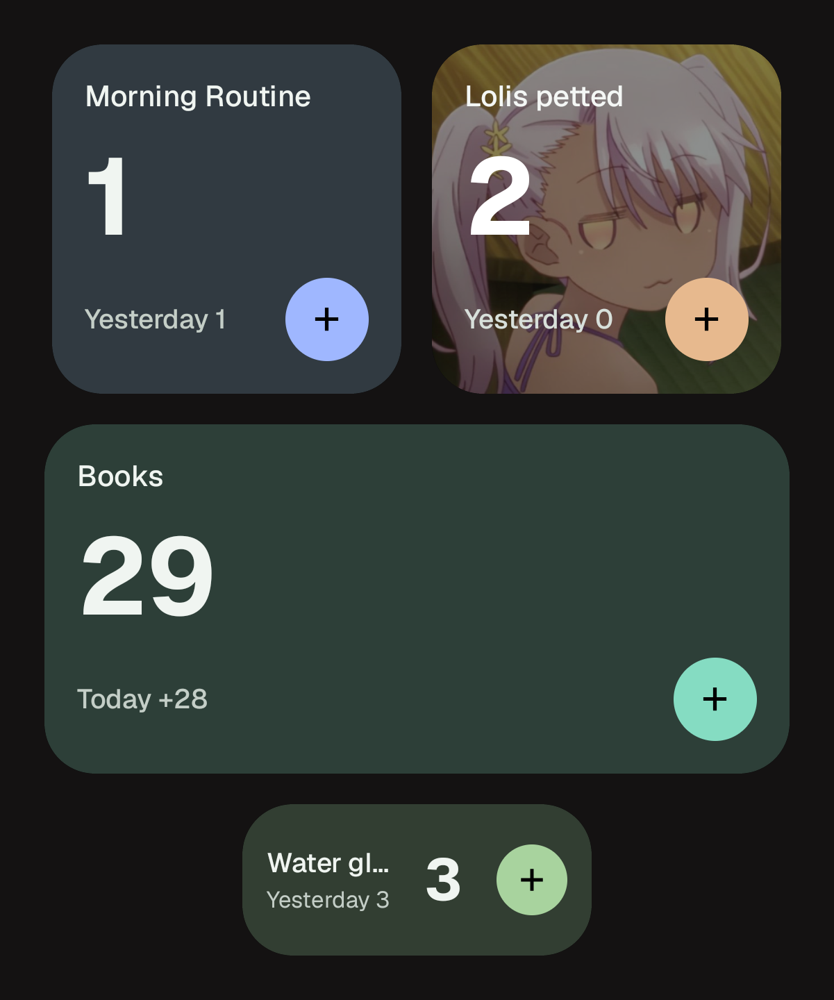
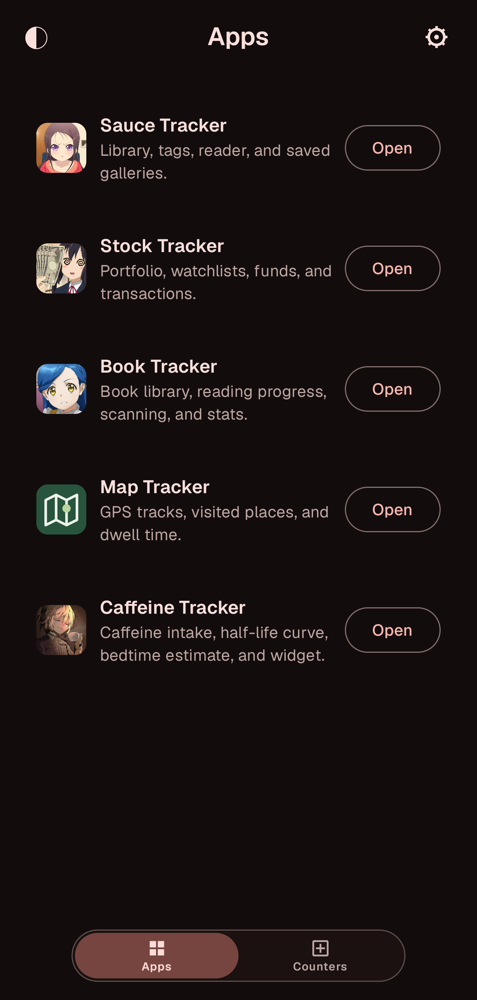
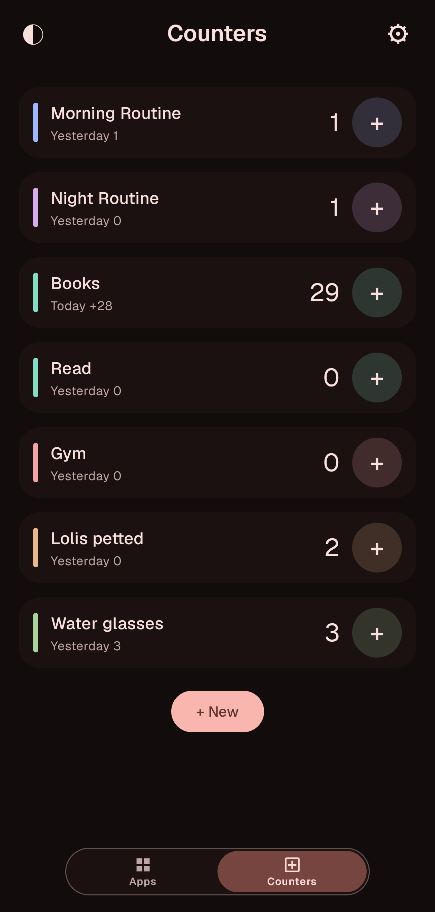
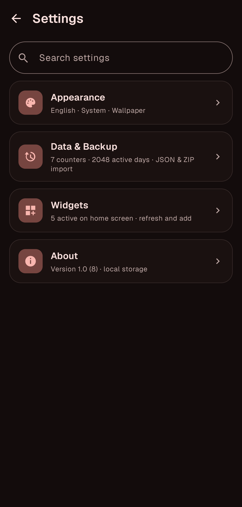

<p align="center">
  
</p>

<h1 align="center">Tracker Hub</h1>

<p align="center">
  A local-first Android hub for your tracker apps with native named counters, customizable home screen widgets, deep statistics, and offline JSON backups.
</p>

<p align="center">
  App Hub&nbsp;&nbsp;•&nbsp;&nbsp;Home Widgets&nbsp;&nbsp;•&nbsp;&nbsp;Custom Image Backgrounds&nbsp;&nbsp;•&nbsp;&nbsp;Scrollable Statistics&nbsp;&nbsp;•&nbsp;&nbsp;Swedish &amp; English&nbsp;&nbsp;•&nbsp;&nbsp;Local Backups
</p>

<p align="center">
  
  
  
  
</p>

Tracker Hub brings together **Sauce Tracker**, **Stock Tracker**, **Book Tracker**, **Map Tracker**, and **Caffeine Tracker** alongside fast, native daily and cumulative counters. Everything stays on your device with zero internet permission, zero ads, and no account required.

## Screenshots

Tracker Hub 1.0 on a real device.

<table>
<tr><th>Widgets (isolated)</th><th>App hub</th></tr>
<tr><td></td><td></td></tr>
<tr><th>Counters</th><th>Settings</th></tr>
<tr><td></td><td></td></tr>
</table>

## Features

- **Unified tracker hub:** Detects installed companion apps (Sauce Tracker, Stock Tracker, Book Tracker, Map Tracker, Caffeine Tracker) so you can open them directly or jump to their GitHub releases.
- **Native counters:** Create unlimited named counters in **Daily reset** mode (resets to 0 at midnight while keeping full history and totals) or **Cumulative** mode (counts continuously across days).
- **Flexible home screen widgets:** Clean adaptive layouts for 1 × 1, 2 × 1, 1 × 2, and 2 × 2+ with rounded `+` buttons, instant background updates, yesterday/today context, accent color palettes, and **optional custom image backgrounds** (automatically cropped, rounded, and scrimmed for readability).
- **Scrollable statistics page:** Tap the 14-day chart to open full statistics with horizontally scrollable charts by **Day**, **Week** (ISO Mon–Sun), **Month**, **Year**, and **All time**, plus averages, streaks, personal records, and weekday breakdown.
- **History & exclude from statistics:** Expand any day in History to view exact timestamps or check **Exclude from statistics** to omit outlier/seed days from charts, averages, and streaks without changing the counter's total. Confirmation dialogs protect destructive actions (*Reset today*, *Delete*, *Replace all*).
- **Languages & theming:** Instant **Swedish and English** language switching (System / Svenska / English) across both the app and home screen widgets, System/Light/Dark themes, selectable accent colors, and Extra dark mode.
- **Local JSON backups:** Exports human-readable `.json` backups (`trackerhub-backup-*.json`) preserving counts, timestamps, and excluded dates. Import validates files and shows a Merge/Replace preview before changing any data.

## Install

Download `Tracker-Hub-1.0-release.apk` and its matching `.sha256` checksum from this repository's **[Releases](https://github.com/Roinur/Tracker-hub/releases)** page. Open the APK on Android 8.0+ and allow installation if prompted, or install via ADB:

```sh
adb install -r Tracker-Hub-1.0-release.apk
```

## Build from source

Requires **JDK 21** and **Android SDK Platform 34**.

```sh
git clone https://github.com/Roinur/Tracker-hub.git
cd Tracker-hub
./gradlew :app:testReleaseUnitTest :app:assembleRelease
```

On Windows, use `.\gradlew.bat`.

### Development commands

```sh
# Run unit tests
./gradlew :app:testDebugUnitTest

# Build debug APK
./gradlew :app:assembleDebug

# Build release APK (uses debug keystore locally unless signing env vars are set)
./gradlew :app:assembleRelease
```

For custom release signing in CI or locally, set `KEYSTORE_PATH`, `KEYSTORE_PASSWORD`, `KEY_ALIAS`, and `KEY_PASSWORD` in your environment. Keep keystores and credentials outside the repository.

## Backups and privacy

- **Zero internet permission:** Tracker Hub does not request `INTERNET` and contains no analytics, ads, or cloud tracking.
- **Atomic local storage:** Counter state is written via `.tmp` → `.bak` → atomic rename with automatic `.bak` fallback recovery.
- **Portable backups:** Native `.json` backups are plain UTF-8 files you can store anywhere; imports always validate and preview changes before applying.

## Credits and source terms

Built by Roinur as the companion hub for Sauce Tracker, Stock Tracker, Book Tracker, Map Tracker, and Caffeine Tracker. Source code and project artwork remain under copyright; see [LICENSE](LICENSE) and [THIRD_PARTY_NOTICES.md](THIRD_PARTY_NOTICES.md).
